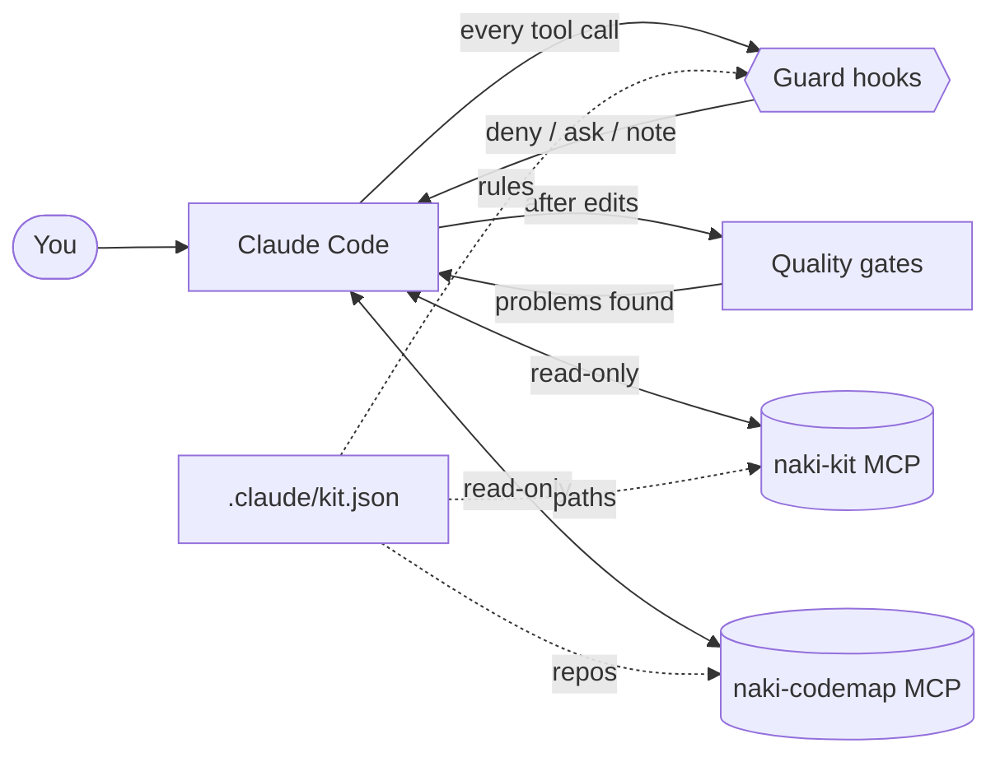
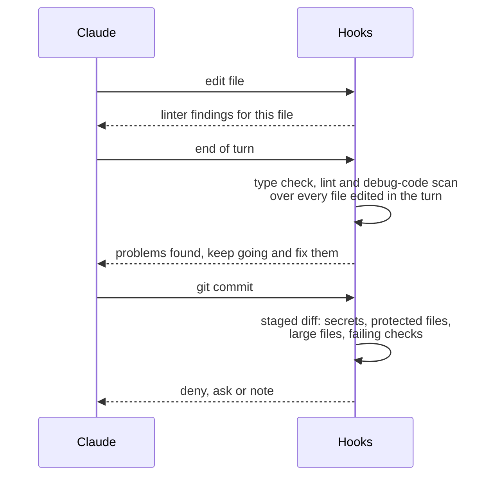

<div align="center">

# Naki Claude Kit

**A complete Claude Code setup: engineering and security knowledge, guard rails, project memory and a Code Map, in one install.**

37 skills · 15 specialist agents · 12 slash commands · guard-rail hooks · quality gates · two local MCP servers

[](#quick-start)
[](#quick-start)
[](#security-and-privacy)
[](#security-and-privacy)
[](#development)
[](LICENSE)

**English** · [Русский](README.ru.md)

</div>

---

## Why

Claude Code is strong out of the box, but every real project has rules it cannot guess: which files are frozen,
which commands cost money, which ones need the GPU, what a commit must never contain. Naki Claude Kit writes those
rules down once, in one JSON file per project, and enforces them on every tool call. It also brings a library of
engineering and defensive security know-how, a structural map of your code, and fast read-only access to the state
of the project.

| | |
|---|---|
| 🧠 **Knowledge** | 23 engineering skills and 14 defensive security skills, all prefixed `naki-` |
| 🤖 **Agents** | 15 specialists: planning, review, security, fixing, testing, incident analysis, threat hunting |
| 🛡️ **Guard rails** | Hooks that block, ask or advise before risky actions, with a short reason Claude can act on |
| ✅ **Quality gates** | Linters after each edit, type checks and a debug-code scan at the end of every turn, a commit gate |
| 🧭 **Session briefing** | Branches, uncommitted work, frozen-file integrity, GPU load and Code Map freshness at session start |
| 🔌 **Project MCP** | Seven read-only tools: overview, frozen files, datasets, results, run costs, status log, GPU |
| 🗺️ **Code Map** | A structural map of the codebase that Claude queries for callers, dependencies and paths |

Everything is plain Python from the standard library. No telemetry, no record of your commands, no network calls.

## How it works



The hooks are registered once for your user. They only act inside projects that have a `.claude/kit.json` above
the working directory, so every other project stays exactly as it was.

## Quick start

Requires Python 3.10 or newer and Claude Code.

```bash
git clone https://github.com/Naki-404/naki-claude-kit.git
cd naki-claude-kit
python -m unittest discover -s tests -q
python install.py user
python install.py project /path/to/your/project --profile generic
python install.py codemap /path/to/your/project
```

Restart Claude Code. On the first start in the project it asks once to approve the MCP servers from `.mcp.json`.

| Step | What it does |
|---|---|
| `install.py user` | Copies skills, agents and commands into `~/.claude`, installs the runtime into `~/.claude/naki-kit` and registers the hooks in `~/.claude/settings.json`, keeping your existing hooks |
| `install.py project <dir> --profile <name>` | Writes `.claude/kit.json`, the profile skill, the `naki-kit` MCP entry in `.mcp.json` and a checksum manifest of protected files |
| `install.py codemap <dir>` | Builds the Code Map for the repositories in `codemap.dirs` and registers the `naki-codemap` MCP server |

Every settings file is backed up as `*.bak-<timestamp>` before it changes.

## What's inside

### Engineering skills

| Area | Skills |
|---|---|
| Backend and data | `naki-python` · `naki-fastapi` · `naki-api-design` · `naki-postgres` · `naki-error-handling` |
| Frontend | `naki-react` · `naki-typescript` · `naki-accessibility` |
| Testing and quality | `naki-tdd` · `naki-python-testing` · `naki-frontend-testing` · `naki-e2e-playwright` · `naki-verify` |
| Delivery | `naki-docker-deploy` · `naki-git-workflow` · `naki-safety` |
| Working on code | `naki-onboarding` · `naki-change-impact` · `naki-search-first` · `naki-adr` |
| ML and LLM | `naki-ml-training` · `naki-llm-apps` |
| Research | `naki-research-writing` |

### Security skills (defensive)

| Area | Skills |
|---|---|
| Operations | `naki-sec-alert-triage` · `naki-sec-incident-response` · `naki-sec-threat-hunting` · `naki-sec-log-analysis` |
| Intelligence and detection | `naki-sec-threat-intel` · `naki-sec-detection-engineering` · `naki-sec-phishing` · `naki-sec-forensics` |
| Application and platform | `naki-sec-web-appsec` · `naki-sec-api-security` · `naki-sec-cloud-containers` · `naki-sec-llm-security` |
| Program | `naki-sec-vuln-management` · `naki-sec-devsecops` |

Skills load automatically when a task matches. Attack techniques appear only to detect and respond to them.

### Agents

| Role | Agents |
|---|---|
| Plan and understand | `naki-planner` · `naki-architect` · `naki-code-explorer` |
| Review | `naki-code-reviewer` · `naki-security-reviewer` · `naki-python-reviewer` · `naki-frontend-reviewer` · `naki-database-reviewer` · `naki-ml-reviewer` · `naki-failure-hunter` |
| Change code | `naki-build-fixer` · `naki-test-writer` · `naki-refactor-cleaner` |
| Security operations | `naki-incident-analyst` · `naki-threat-hunter` |

Ask for one by name, for example "run naki-security-reviewer on this change".

### Commands

| Command | Purpose |
|---|---|
| `/naki-plan` | Restate the task, list risks, write a phased plan and wait for approval |
| `/naki-feature` | Feature work end to end: explore, design, implement test-first, verify |
| `/naki-review` · `/naki-review-pr` | Checklist review of local changes, or a parallel multi-agent review of a pull request |
| `/naki-build-fix` | Fix build, type and lint errors with minimal changes |
| `/naki-tests` | Find untested code and write the missing tests |
| `/naki-refactor` | Remove dead code and duplication, testing after each step |
| `/naki-verify` | Build, types, lint, tests, security grep and diff review with a PASS/FAIL report |
| `/naki-security-audit` | Secrets, dependencies, access control, injection, SSRF and configuration, with fixes |
| `/naki-incident` | Triage a security incident or alert into a full incident report |
| `/naki-onboard` | Map an unfamiliar repository and write a short onboarding guide |
| `/naki-codemap` | Build or refresh the Code Map and summarize the structure |

## Guard rails

Each rule answers in one of three ways: **deny** the action, **ask** you first, or add a **note** for Claude and
let the action through. Every answer carries a short reason that starts with `kit:`.

| Situation | Answer | Example |
|---|---|---|
| Writing to a protected file | deny | editing a frozen test set |
| A shell command that may change a protected file | ask | `sed -i … test_set.jsonl` |
| Reading secrets with a shell command or the Read tool | deny | `cat .env`, reading a `.pem` key |
| Dumping environment variables | deny | `printenv`, `echo $API_KEY` |
| A key or token inside written content | deny | the secret itself never appears in the message |
| SQL that writes, sent through a database MCP server | ask | `UPDATE`, `DELETE`, DDL, `nextval()` in `execute_sql`; reads pass |
| Your own rules for any MCP tool | deny, ask or note | `mcp_rules` |
| Force push, skipped git hooks, disabled signing | deny | `git push --force`, `--no-verify` |
| History-destroying git commands, recursive delete | ask | `git reset --hard`, `rm -rf` |
| A paid run without a budget flag | deny | your own `require_flags` rule |
| GPU jobs, dataset builders, cloud and GitHub changes | ask | your own `ask_commands` rules |
| A dev server or watch mode in the foreground | deny, with a hint to run it in the background | `npm run dev`, `uvicorn` |
| Editing linter, type-checker, test or CI config | ask | `eslint.config.js`, `tsconfig.json` |
| New `# noqa`, `@ts-ignore`, skipped tests | note | |
| A new ad-hoc `NOTES.md` or `SUMMARY.md` outside `docs/` | ask | |
| `git push`, `git commit`, a new dependency | note | a reminder of your project rules |

If a hook itself fails, or `kit.json` is broken, the action goes through. A guard must never block your work.

## Quality gates



- **After each edit**: the configured linter runs on that file and reports only; it never rewrites your code.
- **At the end of the turn**: one pass over everything edited in that turn (type check, lint, and a scan for
  `console.log`, `debugger`, `breakpoint()` added in the diff). If something fails, Claude continues and fixes it.
  It never loops: a second failure in a row only shows a message. The Code Map refreshes in the background.
- **Before a commit**: secrets in the staged diff or a staged `.env` are refused; protected files, files over
  5 MB and failing linters ask first; debug code adds a note.

## Session briefing

At the start of every session Claude receives a few lines of facts, gathered locally:

```text
kit profile 'my-app' active for C:\Users\you\project
platform: branch release-1.0, 3 uncommitted paths
frozen files intact (17 checked)
GPU 0% busy, 1099/12282 MiB used
Code Map for platform is ready; 0 commits since it was built
```

After a context compaction it adds your key project rules again, so they survive long sessions.

## Project MCP: `naki-kit`

| Tool | Returns |
|---|---|
| `kit_project_overview` | Profile, branches and changes per repository, key documents, active rules |
| `kit_verify_frozen` | SHA-256 check of protected files against `.claude/kit-frozen.sha256` |
| `kit_dataset_summary` | Row counts and field distributions of datasets, never the records themselves |
| `kit_results` | Newest result files, or the content of one small text file inside the results folders |
| `kit_run_costs` | Calls, dollars, tokens and error kinds per model and condition |
| `kit_status_log` | The latest sections of your project status log |
| `kit_gpu_status` | GPU load, memory and the processes holding it |

After an approved change to a protected file, refresh the manifest with `python install.py freeze <dir>`.

## Code Map: `naki-codemap`

The Code Map is a structural map of your repositories: modules, classes, functions and methods with their
signatures, and the links between them (calls, imports, inheritance, React components used in JSX, and frontend
HTTP calls linked to the backend routes that serve them). Claude asks it
"who calls this", "what does this touch" or "how does A reach B" and then reads only the files that matter.

| Tool | Use it for |
|---|---|
| `codemap_search` | Find symbols by words from names, docstrings and paths |
| `codemap_symbol` | One symbol: location, signature, route, callers, tests, callees, imports, inheritance |
| `codemap_neighbors` | Everything connected to a symbol, up to three steps away |
| `codemap_path` | The shortest chain from one symbol to another |
| `codemap_tests` | Which tests cover a symbol, directly or through helpers, and which test files to run |
| `codemap_routes` | HTTP routes with their handlers and the frontend functions or Feign clients that call them |
| `codemap_data` | Kafka topics with producers and consumers, DB tables with the methods that write and read them |
| `codemap_hubs` | The most connected symbols, where most of the code flows through |
| `codemap_file` | All symbols of one file with lines and signatures |
| `codemap_stats` | Size of the map, languages, largest areas, parse errors |

- Python is parsed with the standard `ast` module; TypeScript, JavaScript and Java with built-in scanners.
- Java: classes, interfaces, methods with Javadoc, calls resolved through field and parameter types, interface to
  implementation links, Spring routes, Feign clients, Kafka topics (placeholders resolved from
  `application.properties` and `application.yml`) and jOOQ table reads and writes.
- With several repositories in `codemap.dirs` the server serves one merged map: frontend calls and Feign clients
  reach the routes of other services, producers reach consumers through topics. `codemap.http_targets` tells which
  repositories a frontend talks to; `codemap.generic_words` lists words in repository names that say nothing about
  the service (a company prefix, for example) when the service is guessed from a URL variable name. The `repo`
  argument narrows an answer to one repository.
- Routes come from FastAPI/Flask decorators with router prefixes; frontend calls from `api.get("/path")`-style
  clients and `fetch`. `codemap_path` then walks from a button handler through the route to the database code.
- A 400-file repository builds in about a second; later builds re-parse only changed files.
- Only source code is read: data, secrets, virtual environments and build output are never parsed. Add more
  exclusions in `.codemapignore`. The map lives in `.codemap/` and stays out of git.

## Configure a project

All rules live in `.claude/kit.json`. Start from `profiles/generic/kit.json` and add what your project needs:

```jsonc
{
  "profile": "my-app",
  "protected": { "reason": "frozen evaluation data", "paths": ["data/test_*.jsonl"] },
  "require_flags": [
    { "pattern": "python -m experiments\\.run", "any_of": ["--budget"], "reason": "paid run needs a budget" }
  ],
  "ask_commands": [ { "pattern": "train\\.py", "reason": "GPU job, confirm it is free" } ],
  "post_edit":   [ { "name": "ruff", "paths": ["src/**/*.py"], "cmd": [".venv/Scripts/ruff.exe", "check", "{file}"] } ],
  "stop_checks": [ { "name": "tsc", "paths": ["web/src/**/*.ts"], "cmd": ["web/node_modules/.bin/tsc.cmd", "-b"], "cwd": "web" } ],
  "codemap":     { "dirs": ["."] }
}
```

| Key | Meaning |
|---|---|
| `protected` | Paths nobody edits; shell commands touching them need confirmation |
| `secrets` | Secret file names, allowed examples such as `.env.example`, paths skipped by the key scan |
| `git` | Force push, skipped hooks, AI attribution, destructive commands |
| `require_flags` · `ask_commands` · `warn_commands` | Your own deny, ask and note rules for shell commands |
| `mcp_rules` | Rules for MCP tools: `tool` (regex), `field`, `match: "sql_write"`, `pattern`, `unless`, `when`, `decision` |
| `long_running` | Commands that must run in the background |
| `post_edit` · `stop_checks` · `commit_gate` | Checkers after an edit, at the end of a turn and before a commit |
| `debug_patterns` · `guarded_configs` · `suppressions` · `adhoc_docs` | Code hygiene rules |
| `session_context` | What the session briefing shows and which rules return after a compaction |
| `codemap` · `mcp` | Repositories to map, documents, datasets, results and cost files for the MCP tools |

The kit ships with the `generic` profile for any project; copy it and add your own rules.

## Security and privacy

- Standard-library Python only, nothing to download.
- No network access, no telemetry, no record of your commands. The only state is a per-session list of edited
  paths, deleted at the end of each turn, and the Code Map of your own code.
- External programs are started with fixed argument lists and without a shell: `git`, `nvidia-smi` and the
  checkers you list in `kit.json`.
- The MCP servers are read-only and never return dataset records or files outside the configured folders.
- Hooks are a safety net, not a sandbox. Keep Claude Code's own permission prompts on.

Details in [SECURITY.md](SECURITY.md).

## Update and remove

```bash
git pull && python -m unittest discover -s tests -q && python install.py user
python install.py status /path/to/project
python install.py uninstall project /path/to/project
python install.py uninstall user
```

## Development

```text
kit/skills/        37 skills (SKILL.md each)
kit/agents/        15 agents
kit/commands/      12 slash commands
hooks/kit_hooks.py PreToolUse, PostToolUse, Stop and SessionStart in one script
mcp/kit_mcp.py     the naki-kit MCP server (stdio, JSON-RPC)
tools/codemap.py   Code Map engine and the naki-codemap MCP server
profiles/          the generic profile
install.py         install, update, freeze, status, uninstall
tests/             97 unit tests: hooks, commit gate, quality gates, both MCP servers, Code Map, installer
```

Run `python -m unittest discover -s tests -q` after any change to the hooks, the Code Map or a profile.

## License

[MIT](LICENSE) © Naki-404
