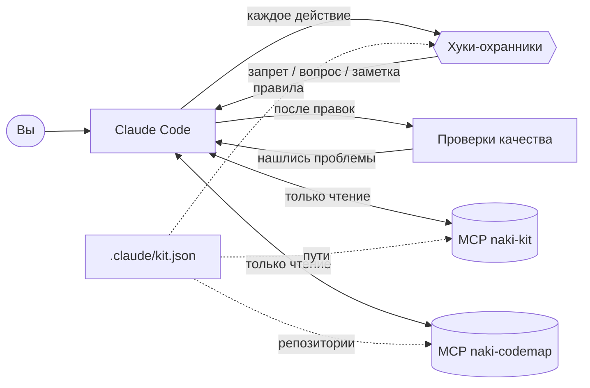
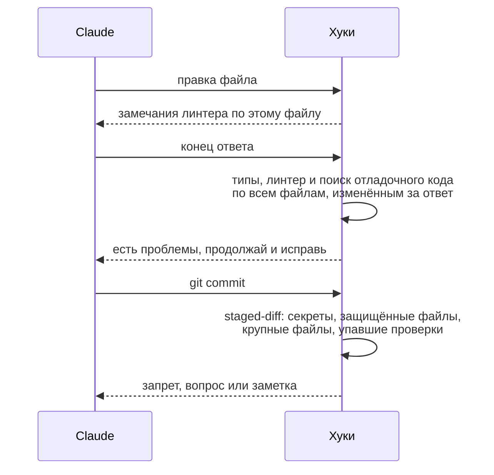

<div align="center">

# Naki Claude Kit

**Полная настройка Claude Code: знания по разработке и безопасности, защитные правила, память о проекте и карта кода в одной установке.**

37 скиллов · 15 агентов-специалистов · 12 команд · хуки-охранники · проверки качества · два локальных MCP-сервера

[](#быстрый-старт)
[](#быстрый-старт)
[](#безопасность-и-приватность)
[](#безопасность-и-приватность)
[](#разработка)
[](LICENSE)

[English](README.md) · **Русский**

</div>

---

## Зачем

Claude Code хорош и без настройки, но у каждого живого проекта есть правила, которые он не угадает: какие файлы
заморожены, какие команды стоят денег, каким нужна видеокарта, что никогда не должно попасть в коммит. Naki Claude
Kit записывает эти правила один раз, в одном JSON-файле на проект, и проверяет их при каждом действии Claude. Кроме
того, в наборе библиотека знаний по разработке и защитной безопасности, структурная карта вашего кода и быстрый
доступ к состоянию проекта только на чтение.

| | |
|---|---|
| 🧠 **Знания** | 23 скилла по разработке и 14 по защитной безопасности, все с префиксом `naki-` |
| 🤖 **Агенты** | 15 специалистов: планирование, ревью, безопасность, починка, тесты, разбор инцидентов, охота за угрозами |
| 🛡️ **Защитные правила** | Хуки запрещают, спрашивают или подсказывают перед рискованным действием и коротко объясняют почему |
| ✅ **Проверки качества** | Линтер после каждой правки, типы и поиск отладочного кода в конце каждого ответа, проверка коммита |
| 🧭 **Сводка в начале сессии** | Ветки, незакоммиченные изменения, целость замороженных файлов, загрузка GPU, свежесть карты кода |
| 🔌 **MCP проекта** | Семь инструментов только на чтение: обзор, замороженные файлы, датасеты, результаты, расходы, статус, GPU |
| 🗺️ **Карта кода** | Структурная карта кодовой базы: кто кого вызывает, от чего что зависит, как связаны части |

Всё написано на Python из стандартной библиотеки. Нет телеметрии, нет записи ваших команд, нет сетевых запросов.

## Как это работает



Хуки подключаются один раз для пользователя. Работают они только в проектах, где выше рабочей папки лежит
`.claude/kit.json`, поэтому в остальных проектах ничего не меняется.

## Быстрый старт

Нужны Python 3.10 или новее и Claude Code.

```bash
git clone https://github.com/Naki-404/naki-claude-kit.git
cd naki-claude-kit
python -m unittest discover -s tests -q
python install.py user
python install.py project /путь/к/проекту --profile generic
python install.py codemap /путь/к/проекту
```

Перезапустите Claude Code. При первом запуске в проекте он один раз спросит, разрешить ли MCP-серверы из `.mcp.json`.

| Шаг | Что делает |
|---|---|
| `install.py user` | Копирует скиллы, агентов и команды в `~/.claude`, ставит рабочие файлы в `~/.claude/naki-kit` и подключает хуки в `~/.claude/settings.json`, не трогая ваши хуки |
| `install.py project <папка> --profile <имя>` | Пишет `.claude/kit.json`, скилл профиля, запись `naki-kit` в `.mcp.json` и манифест контрольных сумм защищённых файлов |
| `install.py codemap <папка>` | Строит карту кода для репозиториев из `codemap.dirs` и подключает MCP-сервер `naki-codemap` |

Перед каждым изменением файла настроек сохраняется копия `*.bak-<время>`.

## Что внутри

### Скиллы по разработке

| Область | Скиллы |
|---|---|
| Бэкенд и данные | `naki-python` · `naki-fastapi` · `naki-api-design` · `naki-postgres` · `naki-error-handling` |
| Фронтенд | `naki-react` · `naki-typescript` · `naki-accessibility` |
| Тесты и качество | `naki-tdd` · `naki-python-testing` · `naki-frontend-testing` · `naki-e2e-playwright` · `naki-verify` |
| Поставка | `naki-docker-deploy` · `naki-git-workflow` · `naki-safety` |
| Работа с кодом | `naki-onboarding` · `naki-change-impact` · `naki-search-first` · `naki-adr` |
| ML и LLM | `naki-ml-training` · `naki-llm-apps` |
| Исследования | `naki-research-writing` |

### Скиллы по безопасности (защита)

| Область | Скиллы |
|---|---|
| Операции | `naki-sec-alert-triage` · `naki-sec-incident-response` · `naki-sec-threat-hunting` · `naki-sec-log-analysis` |
| Разведка и обнаружение | `naki-sec-threat-intel` · `naki-sec-detection-engineering` · `naki-sec-phishing` · `naki-sec-forensics` |
| Приложения и платформа | `naki-sec-web-appsec` · `naki-sec-api-security` · `naki-sec-cloud-containers` · `naki-sec-llm-security` |
| Процессы | `naki-sec-vuln-management` · `naki-sec-devsecops` |

Скиллы подключаются сами, когда подходят к задаче. Техники атак упоминаются только для того, чтобы их обнаружить и отреагировать.

### Агенты

| Роль | Агенты |
|---|---|
| План и понимание | `naki-planner` · `naki-architect` · `naki-code-explorer` |
| Ревью | `naki-code-reviewer` · `naki-security-reviewer` · `naki-python-reviewer` · `naki-frontend-reviewer` · `naki-database-reviewer` · `naki-ml-reviewer` · `naki-failure-hunter` |
| Изменение кода | `naki-build-fixer` · `naki-test-writer` · `naki-refactor-cleaner` |
| Операции безопасности | `naki-incident-analyst` · `naki-threat-hunter` |

Агента можно позвать по имени, например: «проверь это изменение через naki-security-reviewer».

### Команды

| Команда | Назначение |
|---|---|
| `/naki-plan` | Переформулировать задачу, оценить риски, расписать план по фазам и дождаться подтверждения |
| `/naki-feature` | Фича целиком: изучение кода, проектирование, реализация через тесты, проверка |
| `/naki-review` · `/naki-review-pr` | Ревью локальных изменений по чек-листу или параллельное ревью pull request несколькими агентами |
| `/naki-build-fix` | Починить ошибки сборки, типов и линтера минимальными правками |
| `/naki-tests` | Найти непокрытый код и дописать тесты |
| `/naki-refactor` | Убрать мёртвый код и дублирование с проверкой после каждого шага |
| `/naki-verify` | Сборка, типы, линтер, тесты, поиск секретов и разбор diff с отчётом PASS/FAIL |
| `/naki-security-audit` | Секреты, зависимости, права доступа, инъекции, SSRF и настройки, с исправлениями |
| `/naki-incident` | Разобрать инцидент или алерт и составить полный отчёт об инциденте |
| `/naki-onboard` | Разобраться в незнакомом репозитории и написать короткий путеводитель |
| `/naki-codemap` | Построить или обновить карту кода и описать структуру |

## Защитные правила

На каждое правило есть один из трёх ответов: **запрет**, **вопрос** вам или **заметка** для Claude без остановки.
К каждому ответу приложена короткая причина с префиксом `kit:`.

| Ситуация | Ответ | Пример |
|---|---|---|
| Запись в защищённый файл | запрет | правка замороженного тестового набора |
| Команда, которая может изменить защищённый файл | вопрос | `sed -i … test_set.jsonl` |
| Чтение секретов командой или через Read | запрет | `cat .env`, чтение ключа `.pem` |
| Вывод переменных окружения | запрет | `printenv`, `echo $API_KEY` |
| Ключ или токен в записываемом тексте | запрет | сам секрет в сообщение не попадает |
| SQL с записью через MCP-сервер базы | вопрос | `UPDATE`, `DELETE`, DDL, `nextval()` в `execute_sql`; чтение проходит |
| Ваши правила для любых MCP-инструментов | запрет, вопрос или заметка | правило `mcp_rules` |
| Force push, пропуск git-хуков, отключение подписи | запрет | `git push --force`, `--no-verify` |
| Команды, стирающие историю, рекурсивное удаление | вопрос | `git reset --hard`, `rm -rf` |
| Платный прогон без флага бюджета | запрет | ваше правило `require_flags` |
| Задачи на видеокарте, сборщики датасетов, изменения в облаке и на GitHub | вопрос | ваши правила `ask_commands` |
| Dev-сервер или watch-режим не в фоне | запрет с подсказкой запустить в фоне | `npm run dev`, `uvicorn` |
| Правка настроек линтера, типов, тестов, CI | вопрос | `eslint.config.js`, `tsconfig.json` |
| Новые `# noqa`, `@ts-ignore`, пропущенные тесты | заметка | |
| Новый случайный `NOTES.md` или `SUMMARY.md` вне `docs/` | вопрос | |
| `git push`, `git commit`, новая зависимость | заметка | напоминание о правилах проекта |

Если сломался сам хук или `kit.json`, действие проходит: охранник никогда не должен блокировать работу.

## Проверки качества



- **После каждой правки** запускается настроенный линтер по этому файлу. Он только сообщает и никогда не
  переписывает код.
- **В конце ответа** один проход по всему, что изменилось за ответ: проверка типов, линтер и поиск добавленных
  `console.log`, `debugger`, `breakpoint()`. Если что-то не так, Claude продолжает и исправляет. Зацикливания нет:
  при второй неудаче подряд он только показывает сообщение. Карта кода обновляется в фоне.
- **Перед коммитом** секреты в staged-diff и `.env` в индексе запрещены; защищённые файлы, файлы больше 5 МБ и
  упавший линтер требуют подтверждения; отладочный код даёт заметку.

## Сводка в начале сессии

В начале каждой сессии Claude получает несколько строк фактов, собранных локально:

```text
kit profile 'my-app' active for C:\Users\you\project
platform: branch release-1.0, 3 uncommitted paths
frozen files intact (17 checked)
GPU 0% busy, 1099/12282 MiB used
Code Map for platform is ready; 0 commits since it was built
```

После сжатия контекста ключевые правила проекта подставляются заново, чтобы не потеряться в длинной сессии.

## MCP проекта: `naki-kit`

| Инструмент | Что возвращает |
|---|---|
| `kit_project_overview` | Профиль, ветки и изменения по репозиториям, ключевые документы, активные правила |
| `kit_verify_frozen` | Сверку SHA-256 защищённых файлов с манифестом `.claude/kit-frozen.sha256` |
| `kit_dataset_summary` | Число строк и распределение полей датасетов, без самих записей |
| `kit_results` | Свежие файлы результатов или содержимое одного небольшого текстового файла в папках результатов |
| `kit_run_costs` | Вызовы, доллары, токены и виды ошибок по модели и условию |
| `kit_status_log` | Последние разделы статус-лога проекта |
| `kit_gpu_status` | Загрузку и память видеокарты и процессы, которые её занимают |

После одобренного изменения защищённого файла обновите манифест: `python install.py freeze <папка>`.

## Карта кода: `naki-codemap`

Карта кода — структурная карта репозиториев: модули, классы, функции и методы с сигнатурами и связи между ними
(вызовы, импорты, наследование, React-компоненты в JSX, а также HTTP-вызовы фронтенда, связанные с
маршрутами бэкенда, которые их обслуживают). Claude спрашивает её «кто это вызывает», «что это
затрагивает», «как A доходит до B» и потом читает только нужные файлы.

| Инструмент | Для чего |
|---|---|
| `codemap_search` | Найти символы по словам из имён, docstring и путей |
| `codemap_symbol` | Один символ: где лежит, сигнатура, маршрут, кто вызывает, какие тесты, что вызывает, наследование |
| `codemap_neighbors` | Всё, что связано с символом, до трёх шагов |
| `codemap_path` | Кратчайшая цепочка от одного символа к другому |
| `codemap_tests` | Какие тесты покрывают символ, напрямую или через помощники, и какие файлы тестов запускать |
| `codemap_routes` | HTTP-маршруты с обработчиками, функциями фронтенда и Feign-клиентами, которые их вызывают |
| `codemap_data` | Kafka-топики с продюсерами и консьюмерами, таблицы БД с методами, которые их пишут и читают |
| `codemap_hubs` | Самые связанные символы, через которые проходит большая часть кода |
| `codemap_file` | Все символы одного файла со строками и сигнатурами |
| `codemap_stats` | Размер карты, языки, крупнейшие области, ошибки разбора |

- Python разбирается стандартным модулем `ast`, TypeScript, JavaScript и Java — встроенными сканерами.
- Java: классы, интерфейсы, методы с Javadoc, вызовы через типы полей и параметров, переход от интерфейса
  к реализации, маршруты Spring, Feign-клиенты, Kafka-топики (плейсхолдеры берутся из `application.properties`
  и `application.yml`) и чтение и запись таблиц через jOOQ.
- Если в `codemap.dirs` несколько репозиториев, сервер отдаёт одну общую карту: вызовы фронтенда и Feign-клиентов
  доходят до маршрутов других сервисов, продюсеры до консьюмеров через топики. `codemap.http_targets` подсказывает,
  в какие репозитории ходит фронтенд, `codemap.generic_words` перечисляет слова из имён репозиториев, которые
  не помогают угадать сервис по имени URL-переменной (например, имя компании). Аргумент `repo` сужает ответ до
  одного репозитория.
- Маршруты берутся из декораторов FastAPI/Flask с префиксами роутеров, вызовы фронтенда — из клиентов вида
  `api.get("/path")` и `fetch`. `codemap_path` проходит от обработчика кнопки через маршрут до кода работы с базой.
- Репозиторий на 400 файлов строится примерно за секунду; дальше разбираются только изменённые файлы.
- Читается только исходный код: данные, секреты, виртуальные окружения и сборки не разбираются. Свои исключения
  добавляются в `.codemapignore`. Карта лежит в `.codemap/` и не попадает в git.

## Настройка проекта

Все правила лежат в `.claude/kit.json`. Начните с `profiles/generic/kit.json` и добавьте то, что нужно проекту:

```jsonc
{
  "profile": "my-app",
  "protected": { "reason": "замороженные данные оценки", "paths": ["data/test_*.jsonl"] },
  "require_flags": [
    { "pattern": "python -m experiments\\.run", "any_of": ["--budget"], "reason": "платному прогону нужен бюджет" }
  ],
  "ask_commands": [ { "pattern": "train\\.py", "reason": "задача на GPU, проверь, что он свободен" } ],
  "post_edit":   [ { "name": "ruff", "paths": ["src/**/*.py"], "cmd": [".venv/Scripts/ruff.exe", "check", "{file}"] } ],
  "stop_checks": [ { "name": "tsc", "paths": ["web/src/**/*.ts"], "cmd": ["web/node_modules/.bin/tsc.cmd", "-b"], "cwd": "web" } ],
  "codemap":     { "dirs": ["."] }
}
```

| Ключ | Смысл |
|---|---|
| `protected` | Пути, которые никто не правит; команды, затрагивающие их, требуют подтверждения |
| `secrets` | Имена файлов с секретами, разрешённые примеры вроде `.env.example`, пути без проверки на ключи |
| `git` | Force push, пропуск хуков, AI-подпись, разрушительные команды |
| `require_flags` · `ask_commands` · `warn_commands` | Ваши правила запрета, вопроса и заметки для команд |
| `mcp_rules` | Правила для MCP-инструментов: `tool` (regex), `field`, `match: "sql_write"`, `pattern`, `unless`, `when`, `decision` |
| `long_running` | Команды, которые нужно запускать в фоне |
| `post_edit` · `stop_checks` · `commit_gate` | Проверки после правки, в конце ответа и перед коммитом |
| `debug_patterns` · `guarded_configs` · `suppressions` · `adhoc_docs` | Правила гигиены кода |
| `session_context` | Что показывает сводка в начале сессии и какие правила возвращаются после сжатия |
| `codemap` · `mcp` | Репозитории для карты, документы, датасеты, результаты и файлы расходов для MCP |

В наборе профиль `generic` для любого проекта: скопируйте его и добавьте свои правила.

## Безопасность и приватность

- Только Python из стандартной библиотеки, ничего не скачивается.
- Нет сети, телеметрии и записи ваших команд. Единственное состояние — список изменённых за ответ файлов, который
  удаляется в конце ответа, и карта вашего собственного кода.
- Внешние программы запускаются с фиксированными аргументами и без оболочки: `git`, `nvidia-smi` и проверки,
  которые вы указали в `kit.json`.
- MCP-серверы работают только на чтение и не отдают записи датасетов и файлы вне настроенных папок.
- Хуки — страховка, а не песочница. Не отключайте собственные запросы разрешений Claude Code.

Подробнее в [SECURITY.md](SECURITY.md).

## Обновление и удаление

```bash
git pull && python -m unittest discover -s tests -q && python install.py user
python install.py status /путь/к/проекту
python install.py uninstall project /путь/к/проекту
python install.py uninstall user
```

## Разработка

```text
kit/skills/        37 скиллов (по SKILL.md в папке)
kit/agents/        15 агентов
kit/commands/      12 команд
hooks/kit_hooks.py PreToolUse, PostToolUse, Stop и SessionStart в одном скрипте
mcp/kit_mcp.py     MCP-сервер naki-kit (stdio, JSON-RPC)
tools/codemap.py   движок карты кода и MCP-сервер naki-codemap
profiles/          профиль generic
install.py         установка, обновление, манифест, статус, удаление
tests/             97 тестов: хуки, проверка коммита, проверки качества, оба MCP-сервера, карта кода, установщик
```

После любой правки хуков, карты кода или профиля запускайте `python -m unittest discover -s tests -q`.

## Лицензия

[MIT](LICENSE) © Naki-404
